# Laporan Praktikum Basis Data - Pertemuan 01
**Nama:** Adilla Balqis Putri Antoni **NIM:** 25430120 **Kelas:** B **Tanggal:** 25 November 2026 **Dosen:** Dedi Irawan, S.Kom., M.T.I.

## 1. Tujuan Praktikum
Praktikum ini bertujuan untuk memahami cara menjalankan serta memeriksa status layanan MariaDB pada XAMPP, dan menghubungkannya melalui klien CLI ataupun phpMyAdmin. selain itu, mahasiswa diharapkan mampu mengamankan akun 'root' serta membuat akun kerja dengan hak akses terbatas. Praktikum ini juga melatih keterampilan dalam mengelola dan mendokumentasikan proyek menggunakan Git dan GitHub.

## 2. Ringkasan Dasar Teori
MariaDB dan MySQL yaitu sistem manajemen basis data relasional (RDBMS) *open-source* yang memiliki struktur serupa karena MariaDB dikembangkan sebagai turunan (*fork*) dari MySQL. Meskipun keduanya kompatibel secara sintaks dasar, MariaDB menawarkan beberapa peningkatan performa, mesin. penyimpanan tambahan, serta lisensi yang sepenuhnya terbuka dibandingkan MySQL yang dikelola oleh Oracle. Dalam pengelolaannya, administrator sering  memanfaatkan klien *Command Line Interface* (CLI) karena lebih ringan, cepat, dan memungkinkan eksekusi perintah SQL secara langsung maupun melalui skrip otomatisasi. Keamanan serta integritas data pada server database dijaga melalui pengaturan hak akses dan validasi input. Perintah 'GRANT' digunakan untuk memberikan izin spesifik kepada pengguna sesuai prinsip hak akses minimum, sedangkan konfigurasi 'sql_mode' ketat (*strict mode*) memastikan server menolak data yang tidak valid agar tidak merusak konsistensi data.

## 3. Hasil Langkah Percobaan

| No | Langkah | Perintah / aksi | Yang harus terlihat di screenshot | Berkas gambar |
|---|---|---|---|---|
| 1 | Menjalankan MariaDB | XAMPP Control Panel > Start MySQL | Modul hijau, port 3306, log `Status change detected: running` | `img/p01_xampp_hijau.png` |
| 2 | Masuk root & cek versi | `mysql -u root` lalu `SELECT VERSION(), CURRENT_USER();` `SHOW DATABASES;` | Versi MariaDB 10.4.x, daftar basis data sistem | `img/p01_versi_root.png` |
| 3 | Mode SQL | `SELECT @@sql_mode;` | Memuat `STRICT_TRANS_TABLES` | `img/p01_sqlmode.png` |
| 4 | Amankan root | `SELECT User, Host FROM mysql.user WHERE User='root';` lalu `ALTER USER ...` (3 baris) - **sensor password** | Tiga baris root; perintah sukses (jangan tampilkan password asli) | `img/p01_root_aman.png` |
| 5 | Uji tanpa -p | `mysql -u root` (tanpa `-p`) | Pesan ERROR 1045 ... `using password: NO` | `img/p01_error1045.png` |
| 6 | Basis data & akun kerja | `CREATE DATABASE kopma_120 ...; CREATE USER ...; GRANT ...; SHOW GRANTS ...` | Perintah sukses + hasil SHOW GRANTS | `img/p01_grant_mhs.png` |
| 7 | Hak akun kerja | `mysql -u mhs_120 -p` lalu `SHOW DATABASES;` `USE mysql;` | Hanya `information_schema` dan `kopma_120`; `USE mysql` -> ERROR 1044 | `img/p01_akun_kerja.png` |
| 8 | phpMyAdmin mode cookie | Ubah `auth_type` ke `'cookie'`, buka `http://localhost/phpmyadmin` | Halaman login; lalu kueri di tab SQL setelah masuk sebagai `mhs_120` | `img/p01_phpmyadmin.png` |
| 9 | Git push pertama | `git init`, `git add`, `git commit -m "p01: ..."`, `git push -u origin main` | Keluaran push berhasil + akun GitHub | `img/p01_git_push.png` |

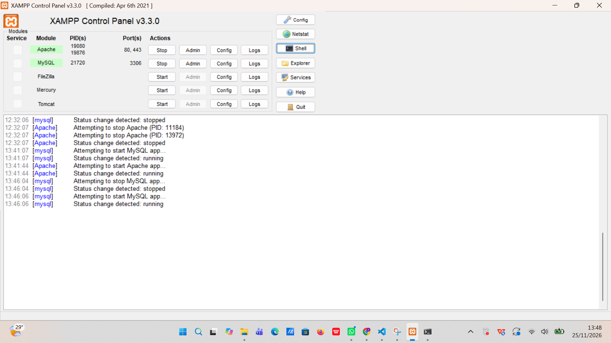

Keterangan: Layanan MariaDB/MySQL pada XAMPP Control Panel berhasil dijalankan dan aktif pada port 3306.

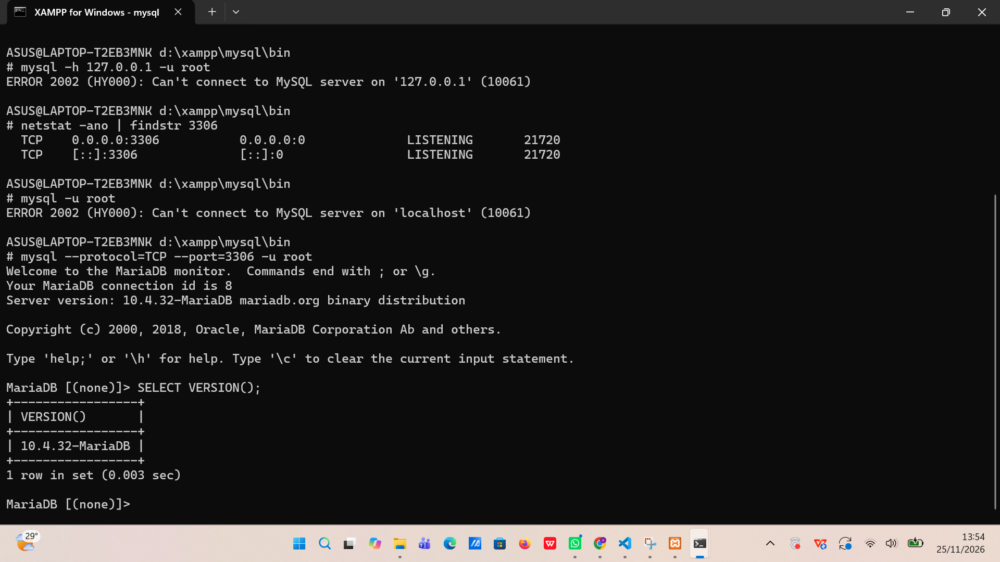

Keterangan: Koneksi berhasil dilakukan melalui antarmuka baris perintah (CLI) menggunakan akun `root` dan menampilkan versi server MariaDB yang aktif.

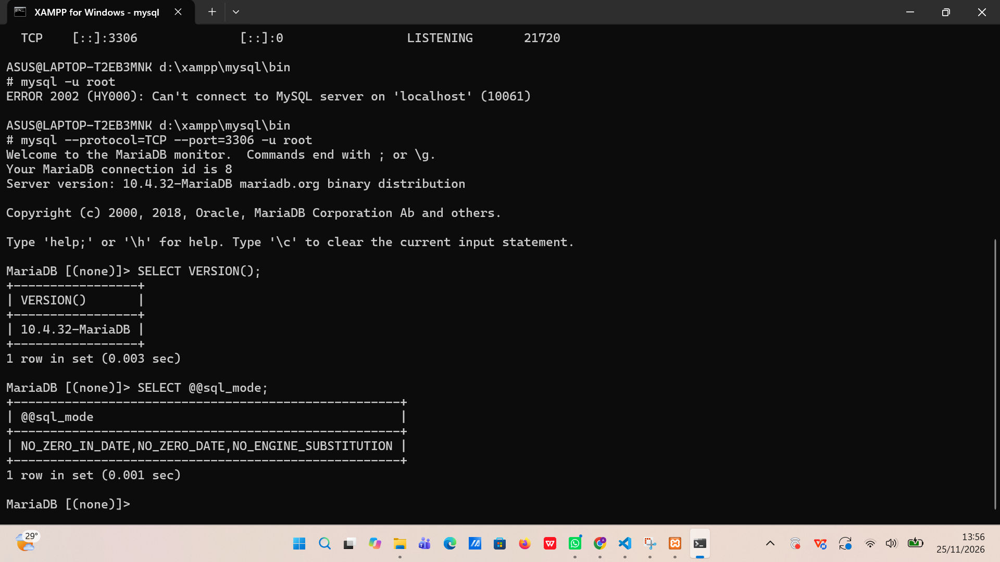

Keterangan: Pengecekan variabel `@@sql_mode` menunjukkan aturan validasi mode ketat (*strict mode*) telah aktif untuk menjaga integritas data.

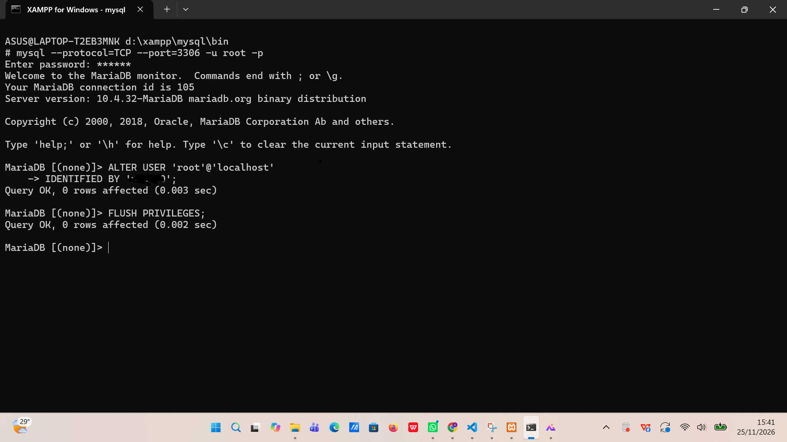

Keterangan: Akun `root` telah diamankan dengan menambahkan kata sandi baru menggunakan perintah `ALTER USER` dan `FLUSH PRIVILEGES`.

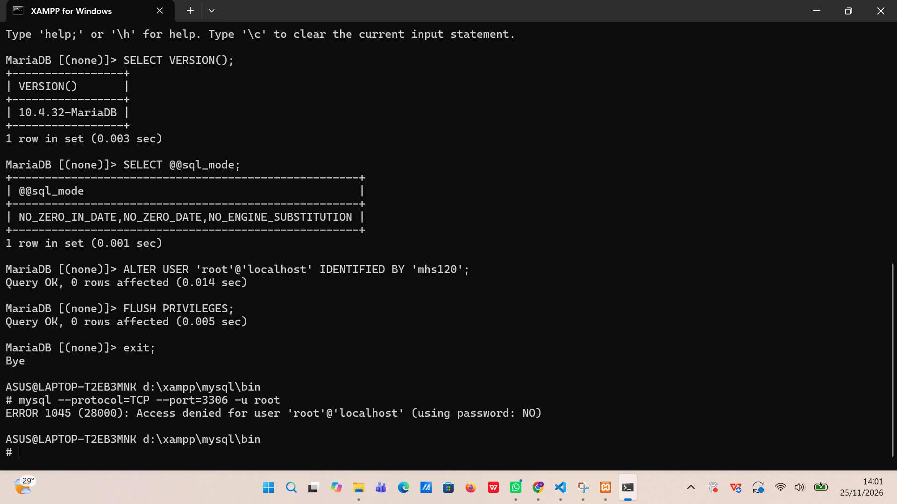

Keterangan: Percobaan masuk sebagai `root` tanpa memasukkan kata sandi ditolak oleh server dengan pesan `ERROR 1045 (Access denied)`.

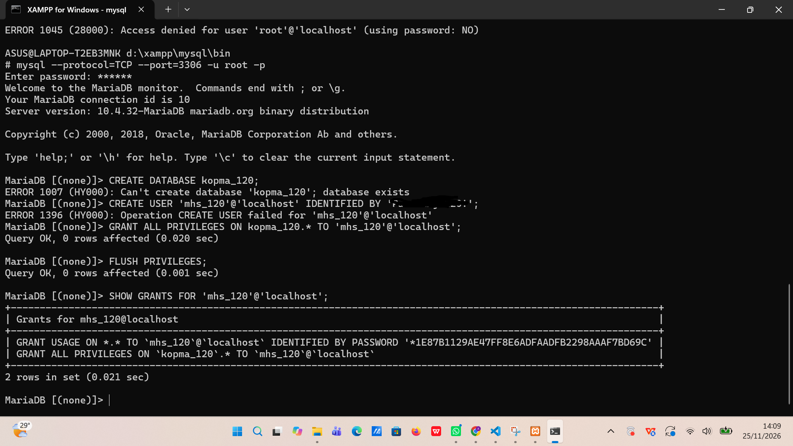

Keterangan: Database `kopma_120` dan akun kerja `mhs_120` berhasil dibuat serta diberikan hak akses penuh hanya pada database tersebut melalui perintah `GRANT`.

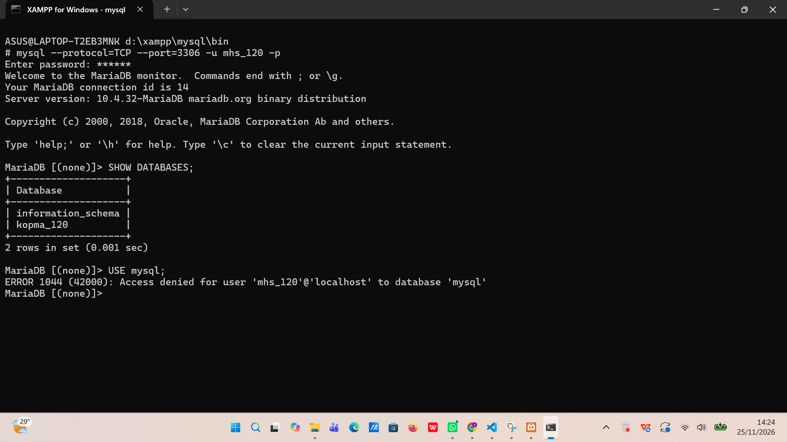

Keterangan: Akun `mhs_120` hanya dapat melihat database `kopma_120` dan ditolak (`ERROR 1044`) saat mencoba mengakses database sistem `mysql`.

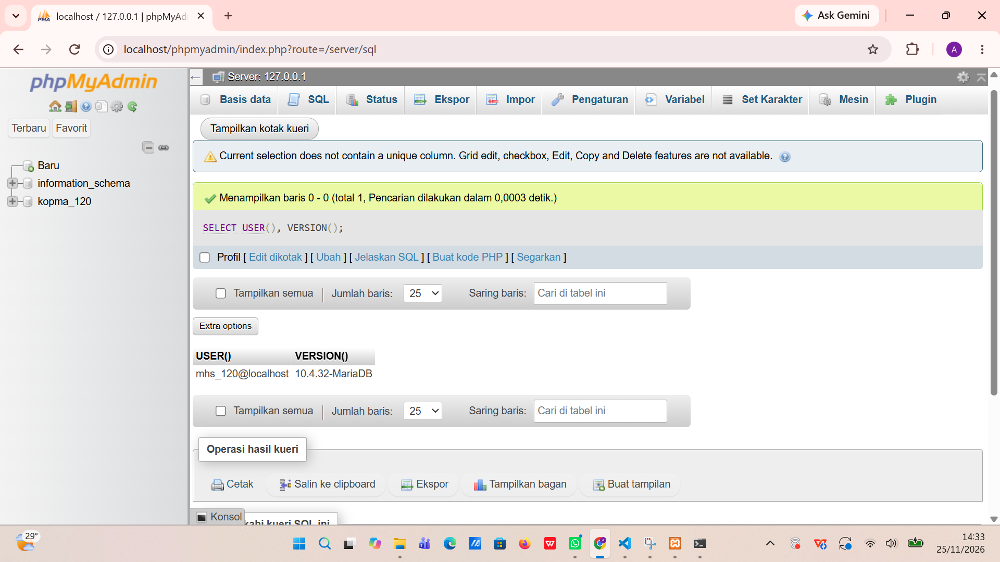

Keterangan: Konfigurasi `auth_type` pada phpMyAdmin telah diubah menjadi mode `cookie` sehingga mewajibkan login, dan akun `mhs_120` berhasil menjalankan kueri pada tab SQL.

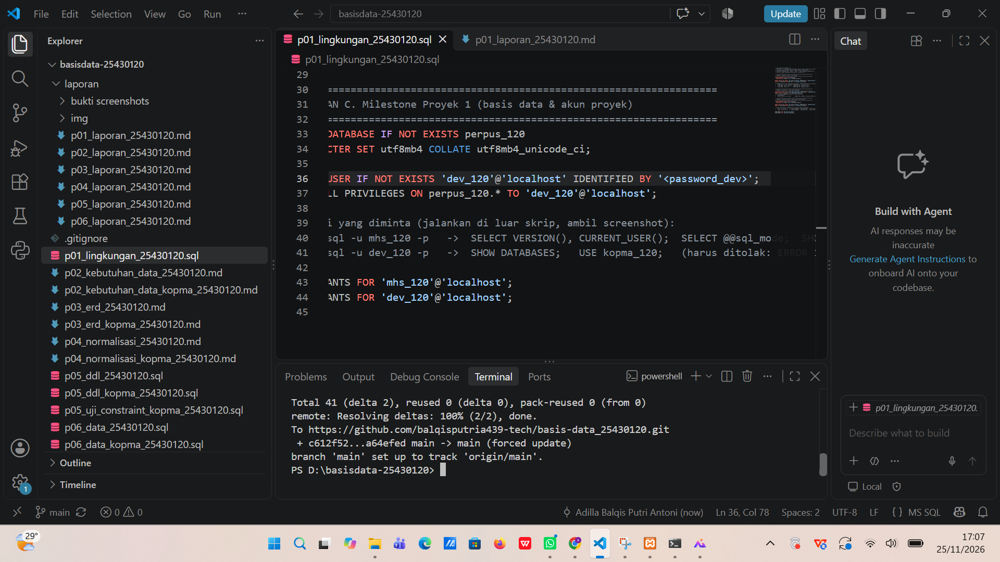

Keterangan: Seluruh berkas laporan, skrip SQL, dan tangkapan layar praktikum telah berhasil diunggah ke repositori GitHub melalui perintah `git push`.

## 4. Jawaban Titik Analisis

**Titik Analisis 1.** Label tombol 'MySQL' padahal yang jalan MariaDB. Apa konsekuensinya saat mencari solusi galat di internet? Kapan dokumentasi MySQL masih relevan, kapan harus MariaDB?

Jawabanku: Konsekuensinya adalahhasil pencarian di internet bisa membingungkan jika solusi tersebut bergantung pada fitur khusus atau perbedaan versi diantara keduanya. Dokumentasi MySQL masih sangat relevan untuk perintah dasar SQL ('SELECT', 'INSERT', 'JOIN'), protokol koneksi, dan pengaturan hak akses umum-misalnya saat mencari arti pesan 'ERROR 1045' atau cara menggunakan perintah 'GRANT'. Sebaliknya, dokumentasi khusus MariaDB wajib dirujuk ketika berkaitan dengan fitur internal, tabel sistem, atau konfigurasi spesifik-misalnya perbedaan pengaturan 'authentication_string' pada tabel 'mysql.user' (atau view 'mysql.user' pada MariaDB 1-.4 ke atas) maupun pengaturan variabel 'sql_mode' khusus MariaDB.

**Titik Analisis 2.** Login `mysql -u root` tanpa `-p` setelah root berpassword: bagian mana pesan galat yang menunjukkan klien tidak mengirim password? Bandingkan dengan Gambar 1.10.

Jawabanku: Bagian pesan galat yang menunjukkan bahwa klien tidak mengirimkan kata sandi adalah frasa penentu di bagian paling akhir, yaitu **'(using password: NO)'** dalam pesan lengkap 'ERROR 1045 (28000): Access denied for user 'root'@'localhost' (using password:N0)'. Hal ini berbeda dengan kondisi pada gambar 1.10 (atau saat login memakai opsi '-p' dengan kata sandi yang keliru), di mana pesan galat diakhiri dengan **'(using password: YES)'** yang menandakan klien sudah mengirimkan kata sandi ke server, tetapi nilai kata sandi tersebut tidak cocok dengan data yang tersimpan.

**Titik Analisis 3.** Mengapa `information_schema` tetap terlihat oleh `mhs_120` tetapi `mysql` ditolak ERROR 1044? Apa beda 1044 dan 1045?

Jawabanku: Database 'information_schema' merupakan basis data virtual bawaan standar SQL yang menyimpan metadata (informasi struktur tabel, kolom, dan hak akses) sehingga selalu dapat dilihat oleh setiap pengguna yang berhasil login sesuai batas hak aksesnya. sebaliknya, database 'mysql' berisi tabel-tabel sistem sensitif seperti data akun pengguna, kata sandi terenkripsi, dan hak akses global sehingga aksesnya dikunci demi keamanan. Perbedaan kedua kode galatnya terletak pada tahap validasi: **'ERROR 1045'**adalah galat **autentikasi** (*siapa kamu?* - login ditolak karena kombinasi username, host, atau password tidak valid), sedangkan **'ERROR 1044'** adalah galat **otorisasi** (*apa yang boleh kamu lakukan?* - pengguna sudah berhasil login, tetapi tidak memiliki izin untuk mengakses database tertentu).

**Titik Analisis 4.** Mengapa mode cookie phpMyAdmin lebih aman daripada mode config?

Jawabanku: Mode 'cookie' lebih aman karena kata sandi tidak disimpan secara permanen dalam teks biasa (*plan text*) di dalam file konfigurasi server ('config.inc.php'), melainkan dimasukkan secara manual saat sesi login dan disimpan sementara dalam bentuk cookie peramban (*browser*) yang terenkripsi. pada mode 'config', siapa pun yang dapat membuka berkas 'config.inc.php' di komputer/server (atau mengakses alamat 'http://localhost/phpmyadmin' dari peramban yang sama) dapat langsung membaca kata sandi 'root' maupun masuk ke database tanpa autentikasi.

## 5. Hasil Latihan dan Modifikasi

1. Akun `tamu_120` hanya SELECT (skrip di `p01_lingkungan`, bagian B). Masuk sebagai tamu, jalankan `CREATE TABLE uji (id INT);`, catat **kode galat** dan jelaskan maknanya sendiri (bandingkan 1044/1045/1142).
2. Skrip `p01_lingkungan_25430120.sql` sudah memakai `IF NOT EXISTS`; **uji sendiri** dengan menjalankannya dua kali (`mysql -u root -p < ...`) dan tempel hasilnya.

Hasil & screenshot: 
1. Saat akun `tamu_120` mencoba menjalankan perintah `CREATE TABLE uji (id INT);`, server menolak dengan pesan **`ERROR 1142 (42000): CREATE command denied to user 'tamu_120'@'localhost' for table 'uji'`**. Perbedaan ketiga kode galat tersebut adalah:
   * **`ERROR 1045` (Autentikasi):** Pengguna gagal masuk ke server karena kombinasi username, host, atau password tidak cocok.
   * **`ERROR 1044` (Otorisasi tingkat database):** Pengguna berhasil login, tetapi tidak memiliki izin sama sekali untuk mengakses database tertentu.
   * **`ERROR 1142` (Otorisasi tingkat tabel/perintah):** Pengguna sudah masuk ke dalam database yang diizinkan (`kopma_120`), tetapi tidak memiliki hak akses untuk perintah spesifik tertentu (seperti `CREATE`, `INSERT`, atau `DROP`) pada tabel di database tersebut.
2. Saat skrip `p01_lingkungan_25430120.sql` dijalankan dua kali berturut-turut menggunakan perintah `mysql -u root -p < D:\basisdata-25430120\p01_lingkungan_25430120.sql`, kedua eksekusi berjalan lancar tanpa pesan galat (*idempotent*) karena pembuatan basis data dan pengguna telah menggunakan klausa `IF NOT EXISTS`.

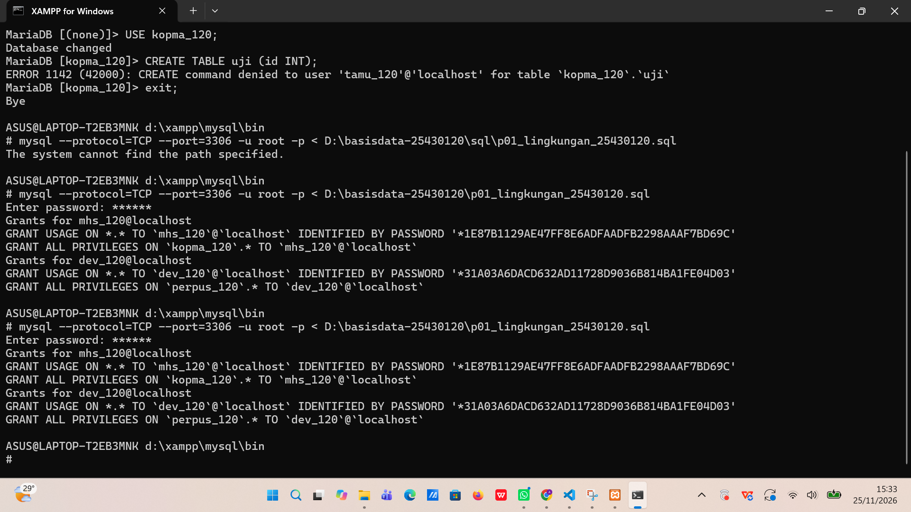

## 6. Tugas Mandiri: Milestone Proyek 01

Berkas di repositori: `README.md` (Identitas Proyek **ISI SENDIRI**: nama organisasi fiktif + 1 paragraf), `.gitignore`, `p01_lingkungan_25430120.sql` (bagian C: basis data & akun proyek `dev_120`).
Bukti: `dev_120` **tidak** bisa membuka `kopma_120` (screenshot galat); commit `p01: milestone proyek 1`.

Keputusan desain & penjelasannya: 
* **Isolasi Lingkungan Proyek:** Pada proyek mandiri ini dibuat basis data khusus bernama `perpus_120` serta akun pengembang `dev_120` yang hanya diberikan hak akses penuh pada `perpus_120.*`. Pemisahan ini memastikan proses pengembangan sistem perpustakaan tidak mengganggu atau merusak data pada basis data praktikum (`kopma_120`).
* **Pemisahan Hak Akses Berdasarkan Peran:** Akun `dev_120` diberikan hak akses penuh (`ALL PRIVILEGES`) khusus di lingkungan `perpus_120` agar leluasa merancang tabel dan menguji data, sedangkan akses ke basis data lain diblokir sepenuhnya (`ERROR 1044` saat mencoba mengakses `kopma_120`).
* **Keamanan Repositori (`.gitignore`):** File `.gitignore` dikonfigurasi untuk mengecualikan berkas sementara, log, maupun file konfigurasi lokal yang berpotensi menyimpan kredensial sensitif agar tidak ikut terunggah ke GitHub.

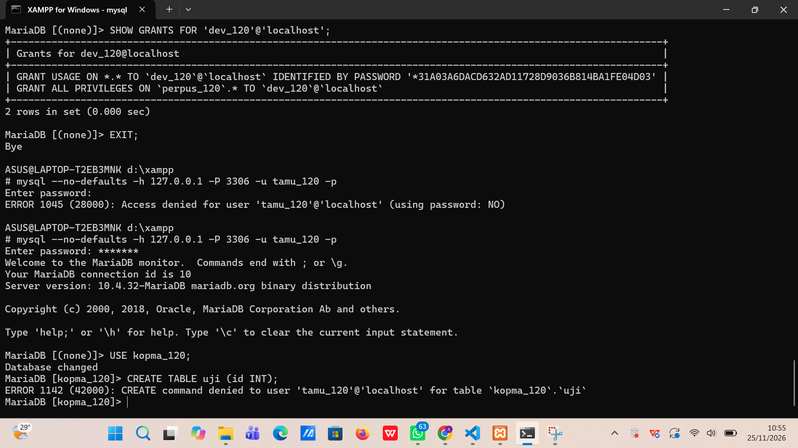

## 7. Pembahasan dan Kendala

galat/kendala 
Selama praktikum berlangsung, terdapat dua kendala teknis utama yang berhasil diatasi:

1. **Galat Koneksi `ERROR 2002 (HY000): Can't connect to MySQL server on 'localhost' (10061)`:**
   * **Cara Membaca Galat:** Pesan ini menunjukkan klien baris perintah (CLI) `mysql` gagal membangun koneksi soket jaringan ke server MariaDB pada `localhost`.
   * **Penyebab & Cara Mengatasi:** Awalnya layanan MySQL pada XAMPP belum dijalankan (*Start*). Setelah dijalankan dan aktif di port `3306`, klien CLI tetap memunculkan galat yang sama karena konfigurasi bawaan port atau soket pada bagian `[client]` tidak mengarah ke port TCP `3306`. Masalah ini diatasi dengan menentukan protokol dan port secara eksplisit menggunakan perintah `mysql --protocol=TCP --port=3306 -u root -p`.

2. **Galat Autentikasi `ERROR 1045 (28000): Access denied for user`:**
   * **Cara Membaca Galat:** Server menolak permintaan masuk karena kombinasi nama pengguna, host, atau kata sandi tidak cocok dengan data yang tersimpan.
   * **Penyebab & Cara Mengatasi:** Terjadi kesalahan pengetikan kata sandi saat mencoba masuk menggunakan akun baru `mhs_120`, serta sempat lupa menyertakan tanda garis bawah (`_`) pada nama pengguna saat login ke phpMyAdmin. Kendala ini diselesaikan dengan masuk kembali sebagai `root`, mengatur ulang kata sandi menggunakan `ALTER USER 'mhs_120'@'localhost' IDENTIFIED BY '...'` diikuti `FLUSH PRIVILEGES;`, lalu memastikan penulisan nama pengguna `mhs_120` sudah tepat.

## 8. Kesimpulan
Melalui praktikum ini, layanan MariaDB pada XAMPP berhasil dijalankan dan diakses baik melalui antarmuka baris perintah (CLI) maupun phpMyAdmin dengan mode autentikasi 'cookie'. Keamanan server basis data telah ditingkatkan dengan mengatur kata sandi akun 'root', mengaktifkan validasi 'sql_mode' ketat, serta menerapkan prinsip hak akses minimum (*least privilege*) melalui pembuatan akun kerja terbatas ('mhs_120' dan 'dev_120'). Selain itu, seluruh berkas konfigurasi SQL, tangkapan layar bukti percobaan, dan laporan praktikum telah terdokumentasi secara terstruktur menggunakan sistem kontrol versi Git dan GitHub.

## 9. Pernyataan Penggunaan AI
pernyataan:
saya menggunakan claude.ai untuk membantu saya memberikan panduan menyusun berkas. dan saya menggunakan bantuan alat kecerdasan buatan (AI) berupa Google Gemini untuk membantu memahami penyebab pesan galat pada klien MySQL/MariaDB (`ERROR 2002`, `ERROR 1045`, dan `ERROR 1142`), menyusun struktur penulisan laporan Markdown agar rapi, serta merangkum penjelasan konsep teknis. Seluruh langkah praktikum, eksekusi perintah SQL, konfigurasi phpMyAdmin, dan pengambilan tangkapan layar dilakukan serta diuji secara langsung pada perangkat pribadi saya.

## 10. Bukti Git

- Repositori: https://github.com/balqisputria439-techbasis-data_25430120.git
- Commit pertemuan ini (`git log --oneline -5`): `a64efed` - pesan `p01: laporan praktikum dan milestone proyek 1`

## Checklist

### Khusus Pertemuan 1
- [x] Berkas: `p01_lingkungan_<NIM>.sql` (dapat dijalankan ulang), `README.md` berisi Identitas Proyek, `.gitignore`
- [x] Screenshot: `SELECT VERSION(), CURRENT_USER(); SELECT @@sql_mode; SHOW DATABASES` sebagai `mhs_<3d>` dan `dev_<3d>`; galat 1044 dan 1142; halaman login phpMyAdmin mode cookie; git push pertama
- [x] Analisis: Titik Analisis 1-4; perbedaan kode galat 1044, 1045, 1142

### Umum
| [x] | Butir | Yang harus ada |
|---|---|---|
| [x] | Identitas | Nama, NIM, kelas, pertemuan, tanggal, nama asisten/dosen |
| [x] | Tujuan | Ditulis ulang dengan bahasa sendiri (maks. 5 baris) |
| [x] | Ringkasan teori | Pemahaman sendiri, maks. setengah halaman, tanpa menyalin buku |
| [x] | Langkah percobaan (D) | Screenshot langkah kunci + keterangan singkat |
| [x] | Titik Analisis | Semua dijawab lengkap dengan alasan |
| [x] | Latihan (E) | Skrip/dokumen + bukti berjalan |
| [x] | Tugas Mandiri (F) | Berkas, bukti, penjelasan keputusan desain |
| [x] | Pembahasan & kendala | Galat yang ditemui, cara membaca, cara mengatasi |
| [x] | Kesimpulan | 2-4 kalimat bahasa sendiri |
| [x] | Pernyataan Penggunaan AI | Alat, untuk apa, bagian mana (atau "tidak menggunakan") |
| [x] | Bukti Git | Tautan repo + hash commit berpesan `pNN: ...` |
| [x] | Keaslian | Setiap screenshot menampilkan akun ber-NIM dan jam sistem; nama objek memuat NIM/inisial |
