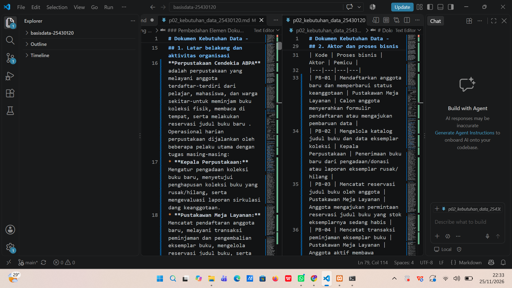
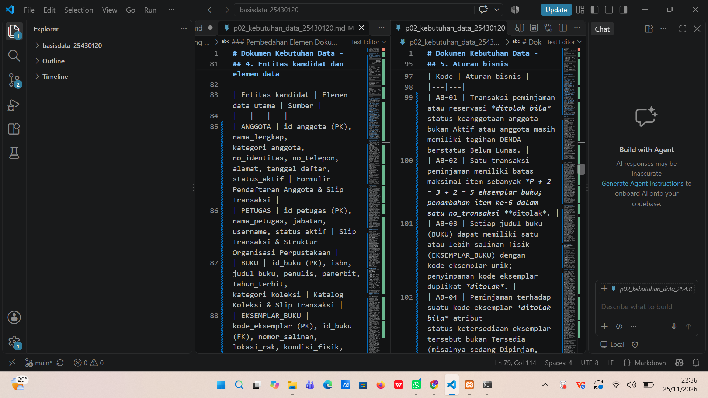
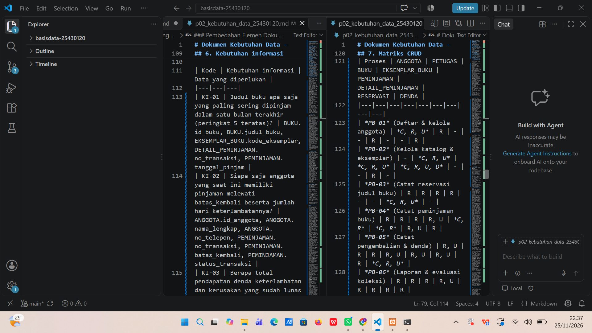
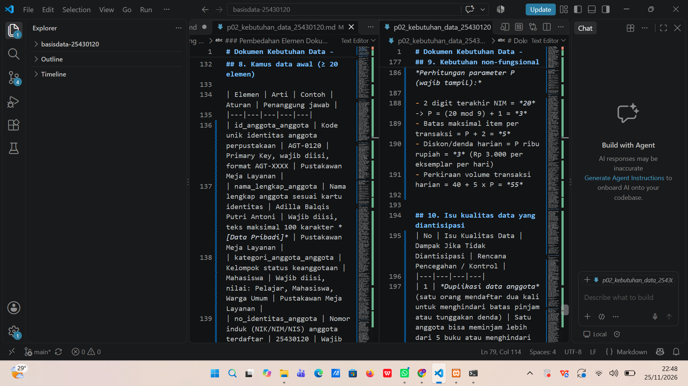

# Laporan Praktikum Basis Data - Pertemuan 02
**Nama:** Adilla Balqis Putri Antoni **NIM:** 25430120 **Kelas:** B **Tanggal:** 25 November 2026 **Dosen:** Dedi Irawan, S.Kom., M.T.I.

> Topik: Analisis kebutuhan pengelolaan data. Bagian bertanda **ISI SENDIRI** adalah tugasmu; kotak `> Panduan` hanya petunjuk,
> hapus sebelum commit akhir. Tiap screenshot wajib menampilkan akun (`mhs_120` / `dev_120`) dan jam sistem Windows.

## 1. Tujuan Praktikum
Mengidentifikasi aktivitas bisnis, aktor, dan alur proses utama dari dokumen sumber. Menurunkan daftar entitas , atribut, serta aturan bisnis yang relevan untuk sistem. Menyusun matriks CRUD untuk memetakan hak akses proses terhadap setiap entitas. Menyusun kamus data den pernyataan kebutuhan pengelolaan data yang spesifik, terukur, serta dapat diuji.

## 2. Ringkasan Dasar Teori
Perancangan basis data melewati empat tahap utama: *analisis kebutuhan* (mengumpulkan aturan dan kebutuhan data), *perancangan konseptual* (membuat model entitas seperti ERD), *perancangan logis* (memetakan entitas ke tabel dan normalisasi), serta *perancangan fisik* (implementasi skema di DBMS). Dalam tata kelolanya, data diperlakukan sebagai aset organisasi yang diawasi oleh **data steward** untuk menjamin kualitas dan konsistensi data.

Kebutuhan digali dari empat sumber (dokumen berjalan, observasi, wawancara pemangku kepentingan, dan sistem yang ada) menjadi empat jenis kebutuhan: *fungsional, **non-fungsional, **kebutuhan data, dan **aturan bisnis. Hubungan proses dengan entitas dipetakan lewat **matriks CRUD* (Create, Read, Update, Delete), sementara detail struktur dan batasan atribut dicatat dalam *kamus data. Agar mudah divalidasi, setiap pernyataan kebutuhan harus ditulis secara **spesifik, **terukur, dan **dapat diuji* (testable).

## 3. Hasil Langkah Percobaan

| No | Langkah | Perintah / aksi | Yang harus terlihat di screenshot | Berkas gambar |
|---|---|---|---|---|
| 1 | Identifikasi latar belakang, aktor, proses bisnis, dan dokumen sumber | Menulis profil Perpustakaan Cendekia ABPA, proses bisnis PB-01 s.d. PB-06, serta slip transaksi & pembedahan datanya pada p02_kebutuhan_data_25430120.md | Bagian 1–3 pada editor VS Code, identitas akun, dan jam sistem Windows | img/p02_01_aktor_dokumen.png |
| 2 | Penurunan entitas kandidat dan perumusan aturan bisnis | Menurunkan 8 entitas kandidat beserta atribut utama dan menyusun 8 aturan bisnis (AB-01 s.d. AB-08) yang dapat diuji | Bagian 4–5 pada editor VS Code, identitas akun, dan jam sistem Windows | img/p02_02_entitas_aturan.png |
| 3 | Penyusunan kebutuhan informasi dan matriks CRUD | Merumuskan 5 kebutuhan informasi (KI-01 s.d. KI-05) dan memetakan operasi CRUD antara proses bisnis dengan 8 entitas | Bagian 6–7 pada editor VS Code, identitas akun, dan jam sistem Windows | img/p02_03_matriks_crud.png |
| 4 | Penyusunan kamus data awal, kebutuhan non-fungsional, perhitungan parameter P, dan isu kualitas data | Melengkapi 25 elemen kamus data beserta penanda data pribadi & penanggung jawab, kebutuhan non-fungsional, perhitungan P = 3, dan 4 isu kualitas data | Bagian 8–10 pada editor VS Code, identitas akun, dan jam sistem Windows | img/p02_04_kamus_kualitas_data.png |

Keterangan: Hasil identifikasi latar belakang organisasi, aktor, proses bisnis (PB-01 s.d. PB-06), serta rancangan slip transaksi peminjaman dan pembedahan elemen datanya pada berkas p02_kebutuhan_data_25430120.md.

Keterangan: Daftar delapan entitas kandidat beserta atribut kuncinya yang diturunkan dari dokumen sumber, dilengkapi delapan aturan bisnis (AB-01 s.d. AB-08) termasuk batas maksimal peminjaman P + 2 = 5 eksemplar.

Keterangan: Pemetaan lima kebutuhan informasi (KI-01 s.d. KI-05) serta matriks CRUD yang memastikan setiap entitas memiliki minimal satu proses penciptaan data (C).

Keterangan: Kamus data awal sebanyak 25 elemen dengan penanda data pribadi dan penanggung jawabnya, kebutuhan non-fungsional, perhitungan parameter NIM (P = 3), serta antisipasi isu kualitas data.

Sisipkan tiap gambar dengan keterangan 1-2 kalimat milikmu, mis.:

Keterangan: ISI SENDIRI

## 4. Jawaban Titik Analisis

**Titik Analisis 1.** Harga barang sudah ada di data barang. Mengapa nota tetap perlu menyimpan harga saat transaksi? Hubungkan dengan keluhan ketua.

> Panduan berpikir: Bayangkan harga pulpen naik bulan depan. Apa yang terjadi pada nota lama bila harganya hanya dibaca dari tabel barang? Lihat AB-04 dan kutipan ketua.

Jawabanku: ISI SENDIRI

**Titik Analisis 2.** Subtotal dan total adalah nilai turunan. Sebutkan satu alasan untuk tidak menyimpannya dan satu alasan yang mungkin membuat total tetap disimpan.

> Panduan berpikir: Alasan 'tidak' berkaitan dengan konsistensi data; alasan 'ya' berkaitan dengan kinerja/arsip. Pikirkan apa yang terjadi bila qty diubah tetapi total lupa diubah.

Jawabanku: ISI SENDIRI

**Titik Analisis 3.** Kolom Pemasok di matriks CRUD tidak punya huruf C. Apa artinya, proses apa yang perlu ditambahkan? Siapa yang mengubah status aktif anggota?

> Panduan berpikir: Baca petunjuk Troubleshooting 4: entitas tanpa C berarti ada proses yang terlewat. Cari juga baris/kolom di tabel yang tidak ada proses yang menyentuh `status_anggota`.

Jawabanku: ISI SENDIRI

## 5. Hasil Latihan dan Modifikasi

1. **Poin loyalitas**: tambahkan elemen data, aturan bisnis (AB-07 dst.), kebutuhan informasi, dan perbarui matriks CRUD. Hitung dulu contoh angkanya sendiri (belanja Rp10.000 = 1 poin; 50 poin = potongan Rp5.000).
2. **Perbaiki tiga pernyataan kabur**: (a) "data anggota harus aman"; (b) "sistem harus cepat mencari barang"; (c) "laporan stok harus akurat". Panduan: ubah jadi spesifik (menyebut data), terukur (angka/kondisi), dapat diuji (Gambar 2.3).

Hasil: ISI SENDIRI

## 6. Tugas Mandiri: Milestone Proyek 02

Berkas `p02_kebutuhan_data_25430120.md` (proyek). Ketentuan minimum ada di checklist dalam berkas itu: ≥4 PB, ≥6 entitas, ≥8 AB, ≥5 KI, CRUD lengkap, kamus ≥20 elemen, non-fungsional, 1 dokumen sumber fiktif, perhitungan P (P-mu = 3).
Berkas Kopma pendamping: `p02_kebutuhan_data_kopma_25430120.md`. Commit `p02: dokumen kebutuhan data kopma` dan commit untuk proyek.

Keputusan desain & penjelasannya: ISI SENDIRI

## 7. Pembahasan dan Kendala

ISI SENDIRI: tulis galat/kendala **yang benar-benar kamu alami**, cara membacanya, dan cara mengatasinya.

> Galat yang umum di modul ini (jangan disalin kalau tidak kamu alami): kebutuhan terlalu umum, proses ditulis sebagai entitas, data historis terhapus tanpa sadar (harga/alamat hanya di entitas induk), entitas yatim di matriks CRUD.

## 8. Kesimpulan
ISI SENDIRI (2-4 kalimat, bahasa sendiri).

## 9. Pernyataan Penggunaan AI
> **ISI SENDIRI DENGAN JUJUR.** Tulis alat apa yang kamu pakai (mis. Claude), untuk apa (mis. menjelaskan
> konsep, menyusun kerangka berkas, memeriksa galat), dan bagian laporan/milestone mana yang terbantu.
> Laporan tanpa pernyataan dianggap tidak memakai AI; bila terbukti sebaliknya saat viva, nilai milestone
> dibatalkan. Kerangka berkas dan skrip Kopma dalam paket ini disusun dengan bantuan AI: **cantumkan itu**,
> dan bedakan dengan bagian yang kamu tulis/uji/analisis sendiri.

Pernyataan:

## 10. Bukti Git

- Repositori: https://github.com/ISI_AKUN_GITHUB/basisdata-25430120
- Commit pertemuan ini (`git log --oneline -5`): `ISI_HASH` - pesan `p02: ...`

## Checklist

### Khusus Pertemuan 2
- ☐ Berkas: `p02_kebutuhan_data_kopma_<NIM>.md` dan `p02_kebutuhan_data_<NIM>.md` (proyek)
- ☐ Screenshot: tabel PB, AB, KI, matriks CRUD, kamus data (tampilan GitHub)
- ☐ Analisis: Titik Analisis 1-3; perhitungan parameter P; perbaikan tiga pernyataan kebutuhan kabur

### Umum
| ☐ | Butir | Yang harus ada |
|---|---|---|
| ☐ | Identitas | Nama, NIM, kelas, pertemuan, tanggal, nama asisten/dosen |
| ☐ | Tujuan | Ditulis ulang dengan bahasa sendiri (maks. 5 baris) |
| ☐ | Ringkasan teori | Pemahaman sendiri, maks. setengah halaman, tanpa menyalin buku |
| ☐ | Langkah percobaan (D) | Screenshot langkah kunci + keterangan singkat |
| ☐ | Titik Analisis | Semua dijawab lengkap dengan alasan |
| ☐ | Latihan (E) | Skrip/dokumen + bukti berjalan |
| ☐ | Tugas Mandiri (F) | Berkas, bukti, penjelasan keputusan desain |
| ☐ | Pembahasan & kendala | Galat yang ditemui, cara membaca, cara mengatasi |
| ☐ | Kesimpulan | 2-4 kalimat bahasa sendiri |
| ☐ | Pernyataan Penggunaan AI | Alat, untuk apa, bagian mana (atau "tidak menggunakan") |
| ☐ | Bukti Git | Tautan repo + hash commit berpesan `pNN: ...` |
| ☐ | Keaslian | Setiap screenshot menampilkan akun ber-NIM dan jam sistem; nama objek memuat NIM/inisial |
