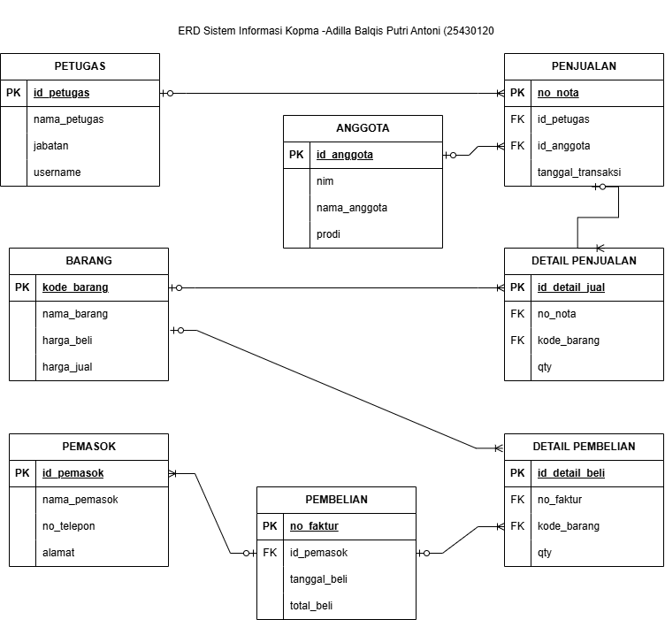

# Laporan Praktikum Basis Data - Pertemuan 03
**Nama:** Adilla Balqis Putri Antoni **NIM:** 25430120 **Kelas:** B **Tanggal:** ISI SENDIRI **Asisten/Dosen:** ISI SENDIRI

> Topik: Pemodelan data dengan ERD. Bagian bertanda **ISI SENDIRI** adalah tugasmu; kotak `> Panduan` hanya petunjuk,
> hapus sebelum commit akhir. Tiap screenshot wajib menampilkan akun (`mhs_120` / `dev_120`) dan jam sistem Windows.

## 1. Tujuan Praktikum
ISI SENDIRI (maks. 5 baris, bahasa sendiri).

> Panduan: Menentukan entitas/atribut/kunci, relasi + kardinalitas + partisipasi berdasarkan aturan bisnis, memecah M:N dengan entitas asosiatif, menggambar ERD Crow's Foot dan memvalidasi terhadap KI.

## 2. Ringkasan Dasar Teori
ISI SENDIRI (maks. setengah halaman, tanpa menyalin buku).

> Panduan - pastikan tercakup: Unsur ERD (entitas, atribut, kunci, atribut turunan, relasi, entitas asosiatif), membaca kardinalitas & partisipasi di notasi Crow's Foot (dekat kotak = maksimum), mengapa M:N tidak bisa langsung jadi tabel.

## 3. Hasil Langkah Percobaan

| No | Langkah | Perintah / aksi | Yang harus terlihat di screenshot | Berkas gambar |
|---|---|---|---|---|
| 1 | ERD Kopma di draw.io | Gambar 8 entitas dengan PK/FK, kardinalitas, legenda, tanda tangan nama+NIM | ERD utuh, kardinalitas terbaca, nama+NIM di sudut | `img/p03_erd_kopma.png` |
| 2 | Tabel relasi | Bagian 2 `p03_erd_kopma_25430120.md` | Tabel relasi + kode AB | `img/p03_relasi.png` |
| 3 | Penelusuran KI | Bagian 3 dokumen yang sama | Tabel KI → jalur | `img/p03_ki.png` |
| 4 | Tinjauan klien | Catatan umpan balik teman | Tabel umpan balik + keputusan | `img/p03_tinjauan.png` |
| 5 | ERD proyek | Gambar dari draw.io | ERD proyek, judul memuat nama organisasi, nama+NIM di sudut | `img/p03_erd_proyek.png` |

Sisipkan tiap gambar dengan keterangan 1-2 kalimat milikmu, mis.:

Keterangan: ISI SENDIRI

## 4. Jawaban Titik Analisis

**Titik Analisis 1.** `no_anggota` dan `nim_anggota` sama-sama unik. Mengapa buku tetap memakai `id_anggota` sebagai PK? Sebut satu risiko jika NIM dijadikan PK.

> Panduan berpikir: Pikirkan sifat NIM: milik pihak luar, bisa berubah/salah ketik/dipakai ulang, dan dipakai sebagai FK di banyak tabel (apa akibatnya bila harus diubah?).

Jawabanku: ISI SENDIRI

**Titik Analisis 2.** Sisi penjualan terhadap detail_penjualan adalah *satu atau banyak*. Aturan bisnis mana yang memaksanya? Dapatkah struktur tabel saja menjaganya?

> Panduan berpikir: Cari AB yang menyebut 'minimal satu baris'. Lalu bayangkan urutan INSERT: nota (kepala) harus ada dulu sebelum detail. Apa yang menghalangi nota dibuat tanpa detail? Simpan jawabanmu untuk Modul 14.

Jawabanku: ISI SENDIRI

**Titik Analisis 3.** Ketua ingin tahu 'petugas gudang mana yang menerima barang'. Dapatkah ERD saat ini menjawab? Bila belum, relasi apa yang perlu ditambah, dan perlukah dicatat sebagai aturan bisnis baru?

> Panduan berpikir: Telusuri jalur: pembelian terhubung ke entitas apa saja saat ini? Adakah penghubung ke petugas? Bila ditambah, tentukan kardinalitas dan dasar AB-nya.

Jawabanku: ISI SENDIRI

## 5. Hasil Latihan dan Modifikasi

1. Tambahkan poin loyalitas ke ERD Kopma: cukup atribut di anggota, atau perlu entitas riwayat poin? Tulis alasanmu (pikirkan: apakah kamu perlu tahu *kapan* dan *dari nota mana* poin didapat/ditukar?).
2. Gambar ulang relasi penjualan-barang sebagai M:N langsung (tanpa entitas asosiatif) dan jelaskan data apa yang hilang (petunjuk: di mana qty dan harga saat transaksi akan ditaruh?).

Hasil: ISI SENDIRI

## 6. Tugas Mandiri: Milestone Proyek 03

Berkas `p03_erd_25430120.drawio`, `p03_erd_25430120.png`, `p03_erd_25430120.md` (tabel relasi + AB, penelusuran KI, ≥1 entitas asosiatif berdata sendiri, standar Tabel 3.3, catatan tinjauan klien ≥2 umpan balik). Commit `p03: erd kopma` dan commit proyek.

Keputusan desain & penjelasannya: ISI SENDIRI

## 7. Pembahasan dan Kendala

ISI SENDIRI: tulis galat/kendala **yang benar-benar kamu alami**, cara membacanya, dan cara mengatasinya.

> Galat yang umum di modul ini (jangan disalin kalau tidak kamu alami): garis relasi tanpa kata kerja, kardinalitas terbalik, atribut turunan digambar sebagai atribut biasa.

## 8. Kesimpulan
ISI SENDIRI (2-4 kalimat, bahasa sendiri).

## 9. Pernyataan Penggunaan AI
> **ISI SENDIRI DENGAN JUJUR.** Tulis alat apa yang kamu pakai (mis. Claude), untuk apa (mis. menjelaskan
> konsep, menyusun kerangka berkas, memeriksa galat), dan bagian laporan/milestone mana yang terbantu.
> Laporan tanpa pernyataan dianggap tidak memakai AI; bila terbukti sebaliknya saat viva, nilai milestone
> dibatalkan. Kerangka berkas dan skrip Kopma dalam paket ini disusun dengan bantuan AI: **cantumkan itu**,
> dan bedakan dengan bagian yang kamu tulis/uji/analisis sendiri.

Pernyataan:

## 10. Bukti Git

- Repositori: https://github.com/ISI_AKUN_GITHUB/basisdata-25430120
- Commit pertemuan ini (`git log --oneline -5`): `ISI_HASH` - pesan `p03: ...`

## Checklist

### Khusus Pertemuan 3
- ☐ Berkas: `p03_erd_kopma_<NIM>` dan `p03_erd_<NIM>` (gambar + sumber diagram)
- ☐ Screenshot: ERD di draw.io dengan kardinalitas terbaca; catatan tinjauan klien
- ☐ Analisis: pemetaan setiap entitas ke PB/KI dari Pertemuan 2; alasan kardinalitas relasi utama

### Umum
| ☐ | Butir | Yang harus ada |
|---|---|---|
| ☐ | Identitas | Nama, NIM, kelas, pertemuan, tanggal, nama asisten/dosen |
| ☐ | Tujuan | Ditulis ulang dengan bahasa sendiri (maks. 5 baris) |
| ☐ | Ringkasan teori | Pemahaman sendiri, maks. setengah halaman, tanpa menyalin buku |
| ☐ | Langkah percobaan (D) | Screenshot langkah kunci + keterangan singkat |
| ☐ | Titik Analisis | Semua dijawab lengkap dengan alasan |
| ☐ | Latihan (E) | Skrip/dokumen + bukti berjalan |
| ☐ | Tugas Mandiri (F) | Berkas, bukti, penjelasan keputusan desain |
| ☐ | Pembahasan & kendala | Galat yang ditemui, cara membaca, cara mengatasi |
| ☐ | Kesimpulan | 2-4 kalimat bahasa sendiri |
| ☐ | Pernyataan Penggunaan AI | Alat, untuk apa, bagian mana (atau "tidak menggunakan") |
| ☐ | Bukti Git | Tautan repo + hash commit berpesan `pNN: ...` |
| ☐ | Keaslian | Setiap screenshot menampilkan akun ber-NIM dan jam sistem; nama objek memuat NIM/inisial |
