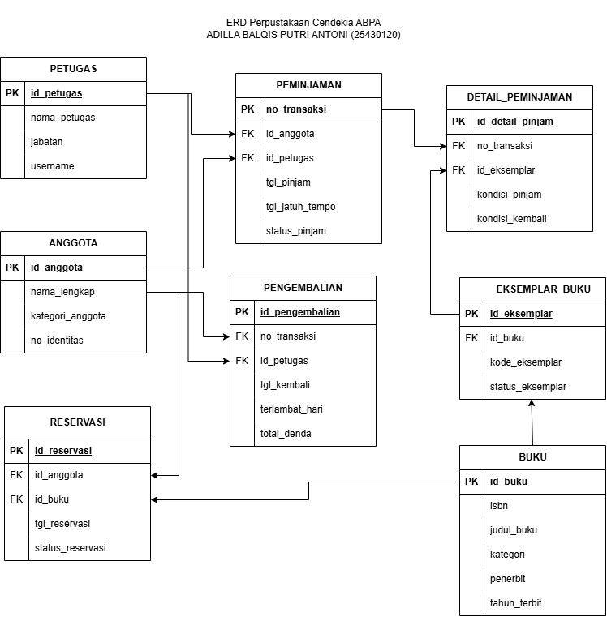

# Laporan Praktikum Basis Data - Pertemuan 03
**Nama:** Adilla Balqis Putri Antoni **NIM:** 25430120 **Kelas:** B **Tanggal:** 26 November 2026 **Dosen:** Dedi Irawan, S.Kom., M.T.I.

## 1. Tujuan Praktikum
Mengidentifikasi entitas, atribut, *primary key* (PK), dan *foreign key* (FK) berdasarkan aturan bisnis. Menentukan relasi, derajat kardinalitas, serta partisipasi antar-entitas secara tepat.Memecah relasi *many-to-many* ('M:N') menjadi dua relasi '1:N' menggunakan entitas asosiatif.Merancang diagram ERD menggunakan notasi *Crow's Foot*.

## 2. Ringkasan Dasar Teori
Entity Relationship Diagram (ERD) adalah model konseptual untuk menggambarkan struktur data dan hubungan antar-objek dalam sistem. Unsur utama ERD meliputi *entitas* (objek/konsep yang datanya disimpan), *atribut* (properti entitas, termasuk Primary Key sebagai pengenal unik, Foreign Key sebagai penghubung antar-entitas, dan *atribut turunan* yang nilainya diperoleh dari hasil perhitungan atribut lain), serta *relasi* (hubungan logis antar-entitas). Untuk relasi many-to-many (M:N), diperlukan *entitas asosiatif* sebagai tabel perantara yang memecahnya menjadi dua relasi 1:N sekaligus menyimpan atribut khusus milik relasi tersebut.

Pada notasi *Crow's Foot, simbol yang berada tepat di dekat kotak entitas menunjukkan **kardinalitas maksimum** (satu atau banyak), sedangkan simbol di sebelah dalamnya menunjukkan *partisipasi/kardinalitas minimum* (wajib/satu atau opsional/nol). Relasi M:N tidak dapat langsung diubah menjadi tabel fisik dalam basis data relasional karena akan memicu redundansi data berlebih, menyulitkan penerapan kunci tamu secara langsung, serta tidak memiliki tempat untuk menyimpan atribut spesifik yang muncul saat kedua entitas berinteraksi.

## 3. Hasil Langkah Percobaan

| No | Langkah | Perintah / aksi | Yang harus terlihat di screenshot | Berkas gambar |
|---|---|---|---|---|
| 1 | ERD Kopma di draw.io | Gambar 8 entitas dengan PK/FK, kardinalitas, legenda, tanda tangan nama+NIM | ERD utuh, kardinalitas terbaca, nama+NIM di sudut | `img/p03_erd_kopma.png` |
| 2 | Tabel relasi | Bagian 2 `p03_erd_kopma_25430120.md` | Tabel relasi + kode AB | `img/p03_relasi.png` |
| 3 | Penelusuran KI | Bagian 3 dokumen yang sama | Tabel KI → jalur | `img/p03_ki.png` |
| 4 | Tinjauan klien | Catatan umpan balik teman | Tabel umpan balik + keputusan | `img/p03_tinjauan.png` |
| 5 | ERD proyek | Gambar dari draw.io | ERD proyek, judul memuat nama organisasi, nama+NIM di sudut | `img/p03_erd_proyek.png` |

Keterangan: Diagram Entity-Relationship (ERD) Sistem Informasi Kopma yang menggambarkan hubungan antar 8 entitas utama beserta atribut Primary Key (PK), Foreign Key (FK), dan kardinalitas relasinya.

Keterangan: Diagram Entity-Relationship (ERD) Sistem Informasi Perpustakaan Cendekia ABPA yang memisahkan entitas katalog buku dengan eksemplar fisik buku serta mencatat alur peminjaman, pengembalian, dan reservasi anggota.

## 4. Jawaban Titik Analisis

**Titik Analisis 1.** `no_anggota` dan `nim_anggota` sama-sama unik. Mengapa buku tetap memakai `id_anggota` sebagai PK? Sebut satu risiko jika NIM dijadikan PK.

Jawabanku: Sistem tetap menggunakan 'id_anggota' sebagai Primary Key (PK) karena atribut tersebut merupakan *surrogate key* internal yang sepenuhnya dikendalikan oleh sistem kopma dan bersifat permanen. Sebaliknya, 'nim_anggota' merupakan data eksternal milik kampus. Satu resiko besar jika NIM dijadikan PK adalah apabila terjadi kesalahan input saat pendaftaran atau perubahan NIM mahasiswa, maka seluruh nilai NIM yang sudah tersimpan sebagai Foreign Key (FK) di berbagai tabel transaksi (seperti penjualan dan simpanan) harus ikut diubah secara massal dan berisiko merusak integritas referensi data.

**Titik Analisis 2.** Sisi penjualan terhadap detail_penjualan adalah *satu atau banyak*. Aturan bisnis mana yang memaksanya? Dapatkah struktur tabel saja menjaganya?

Jawabanku: Aturan bisnis yang memaksa kondisi tersebut adalah ketentuan bahwa setiap transaksi penjualan wajib memiliki minimal satu baris barang yang dibeli (nota penjualan tidak boleh kosong tanpa rincian barang). Struktur tabel relasional dasar (PK dan FK) saja **tidak dapat** menjaganya secara otomatis. Secara urutan eksekusi 'INSERT', data kepala nota ('penjualan') harus dimasukkan  

**Titik Analisis 3.** Ketua ingin tahu 'petugas gudang mana yang menerima barang'. Dapatkah ERD saat ini menjawab? Bila belum, relasi apa yang perlu ditambah, dan perlukah dicatat sebagai aturan bisnis baru?

Jawabanku: ERD saat ini *belum dapat* menjawab pertanyaan tersebut karena entitas pembelian baru terhubung ke entitas pemasok dan barang (melalui detail_pembelian), belum memiliki garis relasi ke entitas petugas. 

Solusinya adalah menambahkan *relasi baru antara petugas dan pembelian* dengan kardinalitas *1:N* (satu petugas dapat menerima nol atau banyak transaksi pembelian 0..*, sedangkan setiap transaksi pembelian wajib diterima dan dicatat oleh tepat satu petugas 1..1). Hal ini **perlu dicatat sebagai Aturan Bisnis (AB) baru*, yaitu: *"Setiap transaksi pembelian/penerimaan barang dari pemasok wajib diverifikasi dan dicatat oleh tepat satu petugas gudang."

## 5. Hasil Latihan dan Modifikasi

1. Tambahkan poin loyalitas ke ERD Kopma: cukup atribut di anggota, atau perlu entitas riwayat poin? Tulis alasanmu (pikirkan: apakah kamu perlu tahu *kapan* dan *dari nota mana* poin didapat/ditukar?).
2. Gambar ulang relasi penjualan-barang sebagai M:N langsung (tanpa entitas asosiatif) dan jelaskan data apa yang hilang (petunjuk: di mana qty dan harga saat transaksi akan ditaruh?).

Hasil: 
1. *Poin Loyalitas ERD Kopma:* Menyimpan atribut poin di entitas anggota saja *tidak cukup* karena hanya mencatat total saldo akhir tanpa jejak historis perolehan maupun penukarannya. Diperlukan *entitas baru bernama riwayat_poin* (yang berelasi dengan anggota dan penjualan) dengan atribut id_riwayat, tanggal_transaksi, jenis_aktivitas (perolehan/penukaran), jumlah_poin, serta Foreign Key id_anggota dan id_penjualan. Dengan struktur ini, sistem dapat melacak kapan poin berubah dan dari nota penjualan mana poin tersebut berasal.
2. *Dampak Relasi penjualan–barang Digambar M:N Langsung:* Jika entitas asosiatif detail_penjualan dihilangkan, maka data rincian transaksi seperti *qty (jumlah unit yang dibeli)* dan *harga_jual saat transaksi* akan hilang atau tidak memiliki tempat penyimpanan yang valid. Atribut tersebut tidak bisa diletakkan di penjualan (karena satu nota memuat banyak jenis barang) maupun di barang (karena jumlah beli berbeda tiap transaksi dan harga barang dapat berubah sewaktu-waktu).

## 6. Tugas Mandiri: Milestone Proyek 03

Berkas `p03_erd_25430120.drawio`, `p03_erd_25430120.png`, `p03_erd_25430120.md` (tabel relasi + AB, penelusuran KI, ≥1 entitas asosiatif berdata sendiri, standar Tabel 3.3, catatan tinjauan klien ≥2 umpan balik). Commit `p03: erd kopma` dan commit proyek.

Keputusan desain & penjelasannya: Pada rancangan ERD proyek **Perpustakaan Cendekia ABPA**, hubungan banyak-ke-banyak (M:N) antara entitas 'PEMINJAMAN' dan 'EKSEMPLAR_BUKU' dipecah menjadi dua relasi 1:N menggunakan entitas asosiatif 'DETAIL_PEMINJAMAN'. Entitas asosiatif ini menyimpan data atribut transaksi mandiri berupa 'kondisi_pinjam' dan 'kondisi_kembali' untuk setiap salinan buku yang dipinjam (maksimal 5 eksemplar per transaksi sesuai AB-02. Selain itu, entitas 'RESERVASI' diarahkan ke entitas master 'BUKU' (bukan 'EKSEMPLAR_BUKU') karena anggota memesan judul buku saat seluruh salinan sedang dipinjam (AB-07)).

## 7. Pembahasan dan Kendala

Kendala yang dialami saat menyusun ERD adalah menentukan partisipasi minimum (wajib 1 atau opsional 0) pada hubungan antara entitas master dan transaksi, serta menjaga konsistensi kata kerja pada garis relasi. Cara mengatasinya adalah dengan menguji ulang setiap garis relasi dari dua arah menggunakan kalimat aturan bisnis yang telah ditetapkan pada Pertemuan 02.

## 8. Kesimpulan
Perancangan ERD dengan notasi Crow's Foot membantu menerjemahkan aturan bisnis menjadi struktur data konseptual yang jelas melalui identifikasi entitas, kunci (PK/FK), dan derajat kardinalitas. Pemecahan relasi M:N menggunakan entitas asosiatif terbukti krusial untuk mencegah redundansi data serta menyediakan tempat penyimpanan yang valid bagi atribut khusus transaksi.

## 9. Pernyataan Penggunaan AI
Pernyataan: 
Saya menggunakan bantuan AI (Google Gemini) untuk membantu memeriksa kesalahan penulisan format Markdown, memvalidasi logika jawaban pada bagian Titik Analisis 3 serta Latihan Modifikasi, dan menyusun kerangka kalimat Kesimpulan. Pembuatan diagram ERD di draw.io, penyusunan tabel relasi dan penelusuran KI proyek mandiri, tinjauan klien bersama rekan, serta eksekusi perintah Git dilakukan secara mandiri.

## 10. Bukti Git

- Repositori: https://github.com/balqisputria439-tech/basis-data_25430120.git
- Commit pertemuan ini (`git log --oneline -5`): `6672125` - pesan `p03: erd kopma dan erd proyek perpustakaan`
-

## Checklist

### Khusus Pertemuan 3
- [x] Berkas: `p03_erd_kopma_<NIM>` dan `p03_erd_<NIM>` (gambar + sumber diagram)
- [x] Screenshot: ERD di draw.io dengan kardinalitas terbaca; catatan tinjauan klien
- [x] Analisis: pemetaan setiap entitas ke PB/KI dari Pertemuan 2; alasan kardinalitas relasi utama

### Umum
| [x] | Butir | Yang harus ada |
|---|---|---|
| [x] | Identitas | Nama, NIM, kelas, pertemuan, tanggal, nama asisten/dosen |
| [x] | Tujuan | Ditulis ulang dengan bahasa sendiri (maks. 5 baris) |
| [x] | Ringkasan teori | Pemahaman sendiri, maks. setengah halaman, tanpa menyalin buku |
| [x] | Langkah percobaan (D) | Screenshot langkah kunci + keterangan singkat |
| [x] | Titik Analisis | Semua dijawab lengkap dengan alasan |
| [x] | Latihan (E) | Skrip/dokumen + bukti berjalan |
| [x] | Tugas Mandiri (F) | Berkas, bukti, penjelasan keputusan desain |
| [x] | Pembahasan & kendala | Galat yang ditemui, cara membaca, cara mengatasi |
| [x] | Kesimpulan | 2-4 kalimat bahasa sendiri |
| [x] | Pernyataan Penggunaan AI | Alat, untuk apa, bagian mana (atau "tidak menggunakan") |
| [x] | Bukti Git | Tautan repo + hash commit berpesan `pNN: ...` |
| [x] | Keaslian | Setiap screenshot menampilkan akun ber-NIM dan jam sistem; nama objek memuat NIM/inisial |
