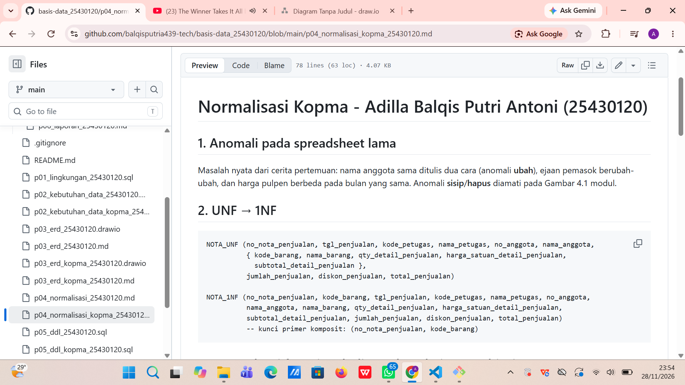
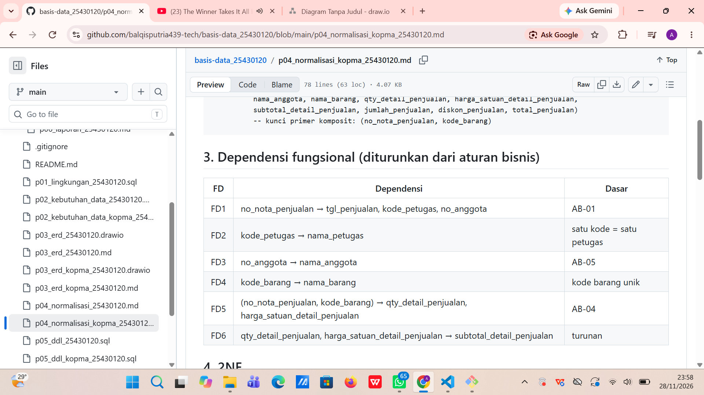
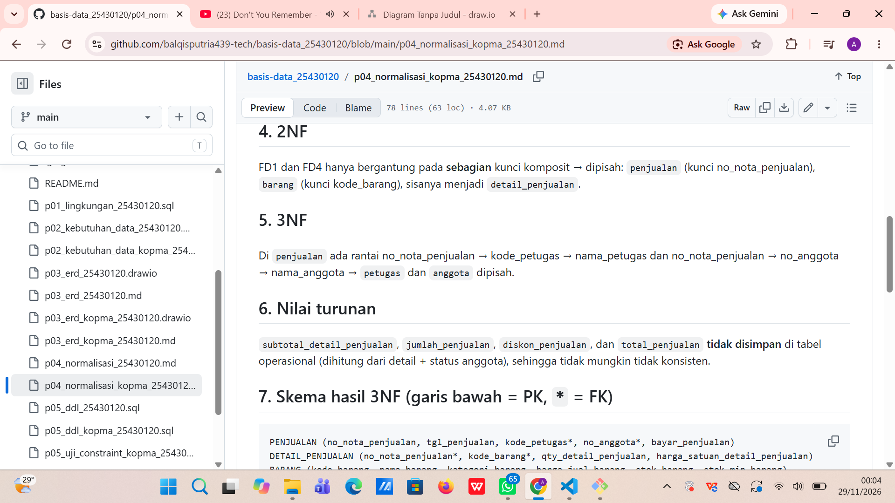
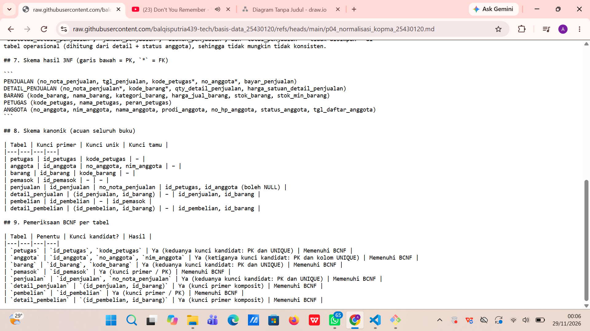
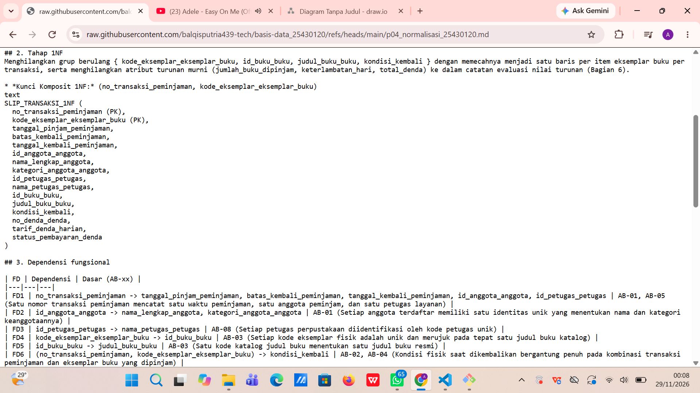

# Laporan Praktikum Basis Data - Pertemuan 04
**Nama:** Adilla Balqis Putri Antoni **NIM:** 25430120 **Kelas:** B **Tanggal:** 28 November 2026 **Dosen:** Dedi Irawan, S.Kom., M.T.I.

## 1. Tujuan Praktikum
Praktikum ini bertujuan agar mahasiswa mampu mengenali tiga jenis anomali pada tabel yang belum ternormalisasi, menuliskan dependensi fungsional berdasarkan aturan bisnis, menormalisasi skema relasi secara bertahap dari UNF hingga 3NF, memverifikasi kepatuhan relasi terhadap BCNF, serta memutuskan penyimpanan atau penghitungan atribut bernilai turunan secara tepat.

## 2. Ringkasan Dasar Teori
Normalisasi relasional adalah proses perancangan skema tabel untuk menghilangkan redundansi data dan mencegah tiga anomali utama: *anomali ubah (*update)* ketika perubahan satu fakta menuntut pembaruan di banyak baris, **anomali sisip (*insert)* ketika data entitas baru tidak bisa dicatat sebelum ada transaksi, serta **anomali hapus (*delete)* ketika penghapusan catatan transaksi ikut menghapus informasi entitas induk. Proses ini bertumpu pada **dependensi fungsional (FD)* $X \rightarrow Y$, di mana nilai atribut penentu $X$ secara unik menentukan nilai atribut $Y$.

Tahapan normalisasi dimulai dari *1NF* (menghilangkan grup berulang dan memastikan setiap sel bernilai atomik), *2NF* (memenuhi 1NF dan bebas dari dependensi parsial terhadap sebagian kunci komposit), *3NF* (memenuhi 2NF dan bebas dari dependensi transitif antar-atribut non-kunci), hingga *BCNF* (Boyce-Codd Normal Form) yang mensyaratkan setiap penentu (determinant) pada FD non-trivial wajib berupa superkey. Selain itu, *kunci pengganti (*surrogate key)* seperti id_barang ditambahkan sebagai kunci primer teknis untuk efisiensi relasi, sementara **kunci alami (*natural key)** seperti kode_barang tetap dipertahankan keunikannya (UNIQUE) sebagai kunci kandidat yang mencerminkan aturan bisnis asli.

## 3. Hasil Langkah Percobaan

| No | Langkah | Perintah / aksi | Yang harus terlihat di screenshot | Berkas gambar |
|---|---|---|---|---|
| 1 | UNF -> 1NF | Bagian 2 p04_normalisasi_kopma_25430120.md | Relasi UNF dan 1NF di pratinjau | img/p04_unf_1nf.png |
| 2 | Dependensi fungsional | Tabel FD1–FD6 + dasar AB | Tabel FD | img/p04_fd.png |
| 3 | 2NF dan 3NF | Bagian 4–7 | Skema hasil 3NF | img/p04_3nf.png |
| 4 | Skema kanonik & BCNF | Bagian 8–9 (BCNF diisi lengkap) | Tabel kanonik + tabel BCNF terisi | img/p04_bcnf.png |
| 5 | Normalisasi proyek | p04_normalisasi_25430120.md | Tahap 1NF–3NF proyek di GitHub | img/p04_proyek.png |

Keterangan: Tangkapan layar bagian 2 pada berkas p04_normalisasi_kopma_25430120.md yang memperlihatkan struktur relasi awal yang belum ternormalisasi (UNF) beserta hasil pemecahan grup berulangnya menjadi bentuk normal pertama (1NF).

Keterangan: Tangkapan layar bagian 3 yang menampilkan daftar dependensi fungsional (FD1 hingga FD6) pada kasus Kopma lengkap dengan kode aturan bisnis (AB) yang mendasari setiap ketergantungan atribut.

Keterangan: Tangkapan layar bagian 4 sampai 7 yang menunjukkan tahapan dekomposisi dependensi parsial (2NF) dan dependensi transitif (3NF) hingga terbentuk skema relasi Kopma yang bersih dari redundansi.

Keterangan: Tangkapan layar bagian 8 dan 9 yang memuat skema kanonik dengan kunci pengganti serta hasil verifikasi BCNF yang memastikan seluruh penentu pada setiap tabel merupakan kunci kandidat.

Keterangan: Tangkapan layar berkas p04_normalisasi_25430120.md di repositori GitHub yang menampilkan tahapan normalisasi 1NF, 2NF, dan 3NF untuk proyek mandiri Sistem Informasi Perpustakaan Cendekia ABPA.

## 4. Jawaban Titik Analisis

**Titik Analisis 1.** Mengapa FD5 menempatkan `harga_satuan_detail_penjualan` pada kunci (no_nota, kode_barang), bukan kode_barang saja? Apa yang terjadi pada laporan omzet tahun lalu bila kolom ini dipindah ke tabel barang?

Jawabanku: Berdasarkan *AB-04*, harga jual barang pada nota transaksi adalah harga yang berlaku pada saat transaksi terjadi, bukan harga master terbaru. Jika harga_satuan_detail_penjualan dipindahkan ke tabel barang, maka ketika harga barang di tabel barang dinaikkan atau diubah hari ini, seluruh perhitungan omzet transaksi tahun lalu akan ikut terhitung ulang menggunakan harga baru sehingga catatan keuangan historis menjadi tidak akurat.

**Titik Analisis 2.** Keputusan 'total tidak disimpan' ditinjau lagi di Buku 2 saat arsip penjualan justru menyimpan total. Mengapa tetap konsisten?

Jawabanku: Keputusan tersebut tetap konsisten karena membedakan antara *data operasional aktif* dan *potret historis (*historical snapshot)**. Pada proses transaksi berjalan, nilai turunan tidak disimpan agar tidak terjadi ketidaksinkronan apabila ada perubahan item detail; namun ketika transaksi sudah selesai dan diarsipkan (Buku 2), total akhir disimpan sebagai catatan historis permanen yang tidak boleh berubah meskipun aturan atau komponen pembentuknya di masa depan diperbarui.

**Titik Analisis 3.** Kolom `pemasok_brg` di spreadsheet lama tidak muncul di tabel barang. Di mana informasi 'barang ini dipasok siapa' kini disimpan? Apa keuntungannya?

Jawabanku: Pada skema kanonik 3NF, informasi pemasok barang kini disimpan melalui keterhubungan antara tabel *pemasok, *pembelian*, dan *detail_pembelian** (di mana pembelian merujuk ke id_pemasok, dan detail_pembelian menghubungkan id_pembelian dengan id_barang). Keuntungannya adalah satu barang dapat dipasok oleh lebih dari satu pemasok berbeda pada transaksi pembelian yang berbeda tanpa menimpa data lama, serta riwayat pergantian pemasok tetap tercatat rapi tanpa menimbulkan grup berulang di tabel barang.

## 5. Hasil Latihan dan Modifikasi

1. Pemasok punya beberapa nomor telepon: normalisasikan dan tulis relasi barunya (petunjuk: atribut multinilai melanggar bentuk normal mana?).
2. Beri satu contoh data yang melanggar 3NF bila `nama_anggota` disimpan di tabel penjualan, dan tulis kueri UPDATE yang memperlihatkan anomali ubahnya.

Hasil: 
1. *Normalisasi atribut multinilai nomor telepon pemasok:*
   Atribut telepon_pemasok yang dapat berisi lebih dari satu nomor melanggar *1NF* (atomisitas). Untuk menormalisasikannya, kolom telepon dipisahkan ke relasi baru *telepon_pemasok* dengan kunci komposit (id_pemasok, no_telepon):
   * pemasok(id_pemasok [PK], kode_pemasok [UNIQUE], nama_pemasok, alamat_pemasok)
   * telepon_pemasok(id_pemasok [PK, FK], no_telepon [PK], jenis_telepon)

2. *Contoh data melanggar 3NF dan kueri SQL anomali ubah:*
   Misalkan pada tabel penjualan (belum 3NF) terdapat kolom nama_anggota yang bergantung transitif melalui no_anggota:
   * Baris 1: no_nota = 'PJ-001', no_anggota = 'ANG-01', nama_anggota = 'Adilla Balqis'
   * Baris 2: no_nota = 'PJ-002', no_anggota = 'ANG-01', nama_anggota = 'Adilla Balqis'

    Jika anggota ANG-01 memperbarui penulisan namanya menjadi 'Adilla Balqis Putri', tetapi kueri pembaruan hanya dijalankan pada satu nomor nota:
   sql
   UPDATE penjualan
   SET nama_anggota = 'Adilla Balqis Putri'
   WHERE no_nota = 'PJ-001';
   
   Akibatnya terjadi *anomali ubah (*update anomaly)**: pada nota PJ-001 nama anggota tercatat 'Adilla Balqis Putri', sedangkan pada nota PJ-002 untuk anggota yang sama (ANG-01) namanya masih tercatat 'Adilla Balqis' (data tidak konsisten).

## 6. Tugas Mandiri: Milestone Proyek 04

Berkas `p04_normalisasi_25430120.md` (proyek): UNF dari satu dokumen sumber, FD + kode AB, tahap 1NF/2NF/3NF, pemeriksaan BCNF, keputusan setiap nilai turunan, catatan perubahan ERD. Commit `p04: normalisasi kopma` dan commit proyek.

Keputusan desain & penjelasannya: Normalisasi proyek mandiri *Sistem Informasi Perpustakaan Cendekia ABPA* pada berkas p04_normalisasi_25430120.md dimulai dari *Dokumen 1: Slip Transaksi Peminjaman & Pengembalian Buku* (SLIP_TRANSAKSI_UNF). Grup berulang daftar eksemplar buku dipecah pada tahap *1NF* dengan kunci komposit (no_transaksi_peminjaman, kode_eksemplar_eksemplar_buku). Selanjutnya diturunkan tujuh dependensi fungsional (*FD1–FD7*) yang berlandaskan aturan bisnis Pertemuan 2 (AB-01 sampai AB-08).

Pada tahap *2NF, dependensi parsial dipisahkan menjadi empat relasi (PEMINJAMAN, DETAIL_PEMINJAMAN, EKSEMPLAR_BUKU, dan DENDA). Pada tahap **3NF, dependensi transitif profil anggota, petugas, dan judul buku dipisahkan sehingga menghasilkan **7 tabel utama* (ANGGOTA, PETUGAS, BUKU, EKSEMPLAR_BUKU, PEMINJAMAN, DETAIL_PEMINJAMAN, dan DENDA) yang seluruh penentunya terbukti merupakan kunci kandidat sehingga memenuhi *BCNF. Untuk nilai turunan, jumlah_buku_dipinjam dan keterlambatan_hari diputuskan **dihitung* dinamis melalui kueri agar selalu konsisten, sedangkan tarif_denda_harian dan nominal_bayar *disimpan* di tabel DENDA sebagai potret historis transaksi. Hasil normalisasi ini telah selaras dengan ERD Pertemuan 3 tanpa memerlukan perubahan struktur entitas utama.

## 7. Pembahasan dan Kendala

Kendala nyata yang dialami selama pengerjaan Pertemuan 4 adalah penamaan berkas gambar tangkapan layar pada folder laporan/img/ yang sempat memiliki ekstensi ganda (.png.png) akibat pengaturan Windows yang menyembunyikan ekstensi berkas secara baku, sehingga gambar tidak tampil pada pratinjau GitHub. Masalah ini teridentifikasi saat memeriksa daftar berkas melalui terminal Git Bash (ls / git status), lalu diatasi dengan menampilkan ekstensi berkas di File Explorer, mengubah nama seluruh berkas menjadi ekstensi .png tunggal, dan mengunggah ulang perubahan ke repositori GitHub. Selain itu, saat memeriksa BCNF pada skema kanonik Kopma, sempat muncul keraguan apakah kolom kode_barang dan no_anggota masih menjadi penentu setelah ditambahkan surrogate key (id_barang, id_anggota), yang kemudian diselesaikan dengan menetapkan kolom kunci alami tersebut sebagai UNIQUE (kunci kandidat).

## 8. Kesimpulan
Proses normalisasi bertahap dari UNF ke 1NF, 2NF, 3NF, hingga pemeriksaan BCNF berhasil menghilangkan redundansi data serta mencegah anomali ubah, sisip, dan hapus pada kasus Kopma maupun proyek Sistem Informasi Perpustakaan Cendekia ABPA. Setiap dependensi fungsional harus diturunkan secara ketat dari aturan bisnis yang berlaku, disertai pemisahan yang jelas antara nilai turunan operasional yang dihitung dinamis dan nilai potret historis yang wajib disimpan permanen.

## 9. Pernyataan Penggunaan AI

Pernyataan: Dalam penyusunan laporan dan penyelesaian tugas Pertemuan 4 ini, saya menggunakan bantuan alat AI (Google Gemini) untuk membantu menyusun struktur penjelasan teori, memverifikasi tahapan dekomposisi normalisasi (1NF, 2NF, 3NF, dan pemeriksaan BCNF) pada studi kasus Kopma dan proyek Perpustakaan Cendekia ABPA, serta mengatasi kendala penamaan ekstensi berkas gambar di Git. Seluruh draf rancangan, pengambilan tangkapan layar hasil kerja pada repositori GitHub, pengujian konsep, serta penyesuaian isi laporan dengan dokumen kebutuhan data proyek Pertemuan 2 dan ERD Pertemuan 3 telah saya periksa, pahami, dan susun kembali secara mandiri.

## 10. Bukti Git

- Repositori: https://github.com/balqisputria439-tech/basis-data_25430120.git
- Commit pertemuan ini (`git log --oneline -5`): `eb593f8` - pesan `Selesaikan normalisasi kopma dan proyek Perpustakaan Cendekia ABPA`

## Checklist

### Khusus Pertemuan 4
- [x] Berkas: `p04_normalisasi_<NIM>.md` (proyek)
- [x] Screenshot: tabel tahapan UNF → 1NF → 2NF → 3NF
- [x] Analisis: daftar dependensi fungsional; keputusan menyimpan/menghitung nilai turunan beserta alasannya

### Umum
| [x] | Butir | Yang harus ada |
|---|---|---|
| [x] | Identitas | Nama, NIM, kelas, pertemuan, tanggal, nama asisten/dosen |
| [x] | Tujuan | Ditulis ulang dengan bahasa sendiri (maks. 5 baris) |
| [x] | Ringkasan teori | Pemahaman sendiri, maks. setengah halaman, tanpa menyalin buku |
| [x] | Langkah percobaan (D) | Screenshot langkah kunci + keterangan singkat |
| [x] | Titik Analisis | Semua dijawab lengkap dengan alasan |
| [x] | Latihan (E) | Skrip/dokumen + bukti berjalan |
| [x] | Tugas Mandiri (F) | Berkas, bukti, penjelasan keputusan desain |
| [x] | Pembahasan & kendala | Galat yang ditemui, cara membaca, cara mengatasi |
| [x] | Kesimpulan | 2-4 kalimat bahasa sendiri |
| [x] | Pernyataan Penggunaan AI | Alat, untuk apa, bagian mana (atau "tidak menggunakan") |
| [x] | Bukti Git | Tautan repo + hash commit berpesan `pNN: ...` |
| [x] | Keaslian | Setiap screenshot menampilkan akun ber-NIM dan jam sistem; nama objek memuat NIM/inisial |
