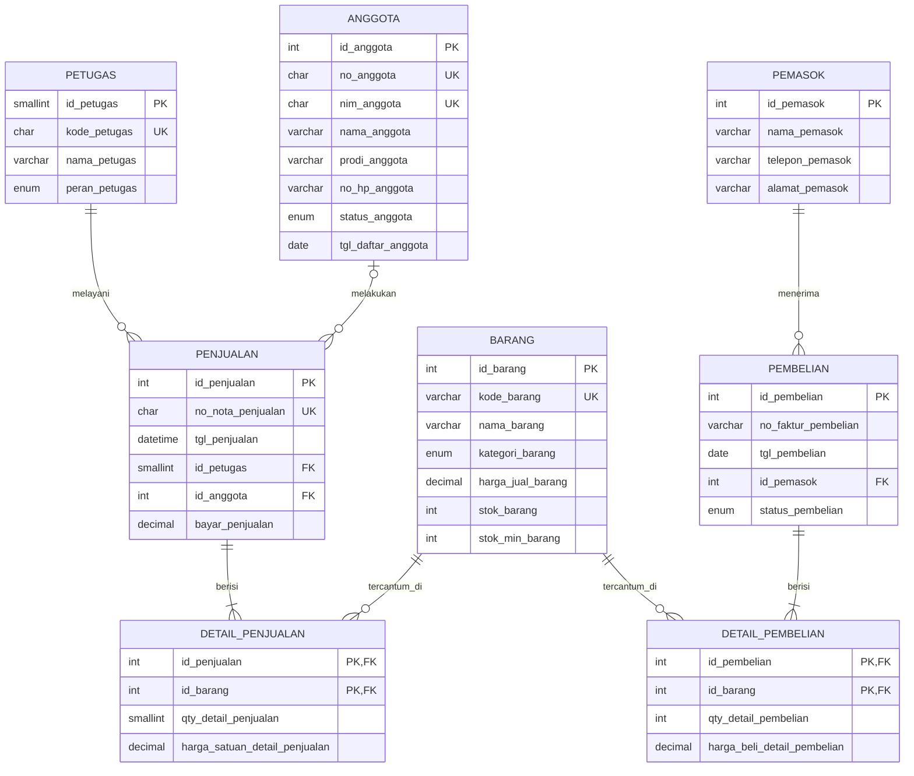

# ERD Kopma - Adilla Balqis Putri Antoni (25430120)

> Gambar utama **wajib dibuat sendiri di draw.io** (`p03_erd_kopma_25430120.drawio` + `.png`), lengkap dengan
> tanda tangan digital (nama + NIM) di sudut diagram. Diagram Mermaid di bawah hanyalah **acuan isi**:
> VS Code/GitHub dapat menampilkannya, tetapi tidak menggantikan berkas draw.io.

## 1. Acuan entitas, atribut, kunci (Mermaid)

> Di draw.io (konseptual, Tabel 3.3): tampilkan label **PK / FK / PK,FK**, kardinalitas **1, 0..1, 0..N, 1..N**
> di kedua ujung garis, satu warna per entitas, dan legenda di bagian bawah. Tipe data/constraint belum wajib
> di Modul 3 (itu ERD fisik, Modul 5).

## 2. Tabel relasi dan kardinalitas (dasar: aturan bisnis)

| Relasi | Sisi kiri | Sisi kanan | Dasar |
|---|---|---|---|
| petugas melayani penjualan | tepat satu petugas | nol atau banyak penjualan | wawancara kasir |
| anggota melakukan penjualan | nol atau satu anggota | nol atau banyak penjualan | AB-02 |
| penjualan berisi detail_penjualan | tepat satu penjualan | satu atau banyak detail | AB-01 |
| barang tercantum di detail_penjualan | tepat satu barang | nol atau banyak detail | AB-04 |
| pemasok menerima pembelian | tepat satu pemasok | nol atau banyak pembelian | AB-06 |
| pembelian berisi detail_pembelian | tepat satu pembelian | satu atau banyak detail | faktur pemasok |

## 3. Penelusuran KI → jalur ERD

| KI | Jalur di ERD | Atribut yang dipakai |
|---|---|---|
| KI-01 Omzet & jumlah nota per hari/bulan | penjualan → detail_penjualan | tgl_penjualan, qty, harga_satuan |
| KI-02 Lima barang terlaris per bulan | detail_penjualan → barang (+ penjualan untuk bulan) | qty, nama_barang, tgl_penjualan |
| KI-03 Stok di bawah minimum | barang | stok_barang, stok_min_barang |
| KI-04 Sepuluh anggota belanja terbesar | anggota → penjualan → detail_penjualan | id_anggota, qty, harga_satuan |

## 4. Catatan tinjauan klien (umpan balik teman sebangku)

> **ISI SENDIRI** setelah sesi tinjauan di kelas - minimal 2 umpan balik, tiap umpan balik dengan keputusan.

| No | Umpan balik (dari siapa) | Keputusan (diterima/ditolak) | Alasan |
|---|---|---|---|
| 1 | ISI SENDIRI | | |
| 2 | ISI SENDIRI | | |
